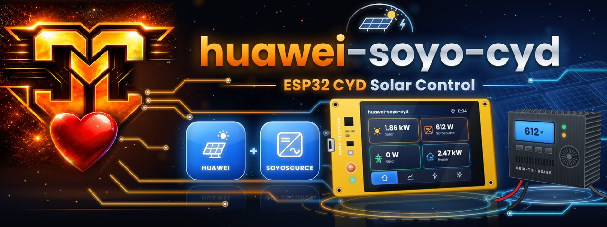



  

<h1 align="center">Huawei · Soyo</h1>
<h3 align="center">Nulleinspeisung am Cheap Yellow Display: SoyoSource speist ein, Huawei R48xx lädt – lokal, ohne Cloud, Home Assistant optional</h3>

  
  
  
  
  
  

  
  
  
  

  <strong>🇩🇪 Deutsch</strong> · <a href="README_EN.md">🇬🇧 English</a>

> **Netzanschluss auf null: Bezug → Soyo speist aus dem Akku ein, Überschuss → Huawei lädt den Akku.**

---

Eine Firmware für das günstige **ESP32-2432S028R** („Cheap Yellow Display“, 2,8″ Touch), die den Netzanschluss auf **null** regelt – mit Akku, **SoyoSource**-Wechselrichtern und **Huawei R48xx**-Netzteilen.

| Am Netzanschluss … | … reagiert | Weg der Energie |
| --- | --- | --- |
| **Bezug** (Haus braucht Strom) | **SoyoSource** speist ein | Akku → Haus |
| **Einspeisung** (z. B. PV-Überschuss) | **Huawei** lädt | Netz → Akku |

## 🚧 Beta – Tester und Ideen willkommen!

Alles ist eingebaut, aber an echter Hardware **noch nicht vollständig getestet**. Mit kleiner Leistung beginnen und jedes Gerät einzeln prüfen. Wer Huawei, Soyo, Shelly oder Home Assistant dran hat und testen mag: Rückmeldungen, Logs und Ideen sind sehr willkommen!

---

## Inhalt

- [Funktionen](#funktionen)
- [Teile](#teile)
- [Anschluss](#anschluss)
- [Firmware aufspielen](#firmware-aufspielen)
- [Erster Start](#erster-start)
- [Bedienung am Display](#bedienung-am-display)
- [Weboberfläche](#weboberfläche)
- [Mehrere Huawei-Netzteile](#mehrere-huawei-netzteile)
- [Shelly vor dem Huawei](#shelly-vor-dem-huawei-optional)
- [MQTT und Home Assistant](#mqtt-und-home-assistant)
- [Sicherheit](#sicherheit)
- [Fehlersuche](#fehlersuche)
- [Support & Spenden](#-support--spenden)
- [Technik und Lizenzen](#technik-und-lizenzen)

## Funktionen

- **Nulleinspeisung** auf einen einstellbaren Restbezug (ab Werk 25 W). Soyo und Huawei laufen **nie gleichzeitig**: Vor jedem Richtungswechsel stehen beide 5 s auf 0 W, Soyo wird erst freigegeben, wenn der Huawei unter 40 W aufnimmt – so kann sich nichts gegenseitig hochregeln.
- **Nur Laden** mit fester Leistung (100–2000 W), Start nur mit 3 s Halten, Stopp sofort.
- **Mehrere Geräte:** bis zu 32 SoyoSource (RS485) und bis zu 3 Huawei (CAN).
- **Netzmessung** per Shelly (EM, 3EM, Pro EM, Pro 3EM, EM Gen4) oder beliebigem **MQTT**-Wert mit JSONPath.
- **Home Assistant** per MQTT-Discovery: alle Werte erscheinen von selbst.
- **Automatischer Neustart** der Nulleinspeisung nach Stromausfall, sobald Messwerte da sind.
- **Einrichtung per Handy:** Einrichtungs-WLAN mit Captive Portal, WLAN-Suche, Weboberfläche mit Passwort.
- **Huawei-Detailseite:** Kachel antippen → Spannung, Strom, Leistung, Temperatur und Wirkungsgrad jedes Netzteils.
- **Log auf microSD-Karte:** alle 10 s eine Zeile und alle Ereignisse; ist die Karte voll, werden die ältesten Dateien gelöscht.
- **Display-Schlaf:** nach 60 min aus, wieder an per Antippen oder bei hellem Licht (Lichtsensor).
- **Shelly vor jedem Huawei (optional):** misst die Aufnahme und schaltet einen Huawei ab, wenn sein CAN abreißt.
- **Deutsch und Englisch**, Design wie Simple Open Camper.

## Teile

| Teil | Wofür | Bezugsquelle |
| --- | --- | --- |
| ESP32-2432S028R („Cheap Yellow Display“, 2,8″) | Regler mit Display | [bei Amazon](https://link.amazon/B00jjmvuF) |
| CAN-Transceiver SN65HVD230 (3,3 V) | Huawei-Netzteile | [bei Amazon](https://link.amazon/B02DRQBV8) |
| RS485-Wandler mit automatischer Senderichtung | SoyoSource-Wechselrichter | [bei Amazon](https://link.amazon/B092okQsP) |
| Shelly-Energiezähler am Netzanschluss | Netzmessung | oder ein anderer Zähler per MQTT |
| je Huawei ein Shelly mit Schalter und Messung (z. B. Plug, 1PM) | Abschalten bei CAN-Ausfall | optional |

Wichtig: Für CAN einen **3,3-V-Transceiver** wie den SN65HVD230 nehmen, **kein MCP2515**-Modul – der CAN-Controller steckt schon im ESP32.

## Anschluss

Jedes Modul bekommt seinen eigenen Stecker am CYD.

### Stecker CN1 → CAN-Modul (Huawei)

| CN1 am CYD | SN65HVD230 |
| --- | --- |
| 3,3 V | 3V3 |
| GND | GND |
| IO22 | CTX |
| IO27 | CRX |

- **CANH / CANL** gehen parallel an alle Huaweis. Die Pins am Huawei-Stecker stehen im Handbuch des eigenen Modells (z. B. R4850G2-Handbuch V2.2: Pin 11/12, V1.4: Pin 13/14).
- **125 kbit/s.** Ein CAN-Bus braucht genau zwei **120-Ω-Abschlusswiderstände**, einen an jedem Ende. Die SN65HVD230-Platinen haben meist schon einen. Prüfen: alles aus, zwischen CANH und CANL messen – richtig sind etwa **60 Ω**.

### Stecker P1 (UART neben der USB-Buchse) → RS485-Wandler (Soyo)

| P1 am CYD | RS485-Wandler |
| --- | --- |
| VIN (5 V) | VCC |
| GND | GND |
| TX (GPIO1) | DI / TXD |
| RX (GPIO3) | **nicht anschließen** |

- **A / B** gehen parallel an alle Soyos (kommt nichts an: A und B tauschen). 4800 Baud, alle Soyos im **RS485-Limiter-Modus**.
- **Warum RX frei bleibt:** Die Soyos empfangen im Limiter-Modus nur, sie antworten nicht. Und RX am P1 hängt intern am USB-Chip – darüber kommt beim Hochladen die Firmware vom PC. Der RXD-Pin des Wandlers ist ein Ausgang; angeschlossen würden zwei Ausgänge gegeneinander arbeiten, das Hochladen klappt dann nicht mehr.

### Warum nicht der Stecker P3 (GND, IO35, IO22, IO21)?

- **IO22** ist derselbe Pin wie auf CN1 (auf der Platine verbunden) und dort schon belegt.
- **IO35** kann nur lesen, **IO21** ist die Hintergrundbeleuchtung des Displays.
- P3 hat **keine 3,3 V**. Damit reicht P3 für keines der beiden Module allein.

**Folge der Belegung:** Soyo nutzt den USB-Seriell (UART0), daher gibt es keine seriellen Debug-Ausgaben. Fehlersuche läuft über die Weboberfläche. Hochladen über USB geht weiter. Beim Einschalten laufen kurz Bootmeldungen über den Soyo-Bus; die Soyos verwerfen sie (falsche Baudrate und Prüfsumme).

## Firmware aufspielen

**⚡ [Online-Flasher](https://cyclemat.github.io/huawei-soyo-cyd/flasher/) (am einfachsten):** im Browser öffnen (Chrome oder Edge am PC), CYD per USB anschließen, Knopf drücken, Anschluss wählen – ohne Download und ohne Installation. **„Nur Firmware (Update)“** lässt die Einstellungen stehen, **„Komplett (neu einrichten)“** löscht alles. Den RS485-Wandler am Stecker P1 vorher abziehen, er hängt am selben seriellen Anschluss.

**Web-Flasher auf dem eigenen Rechner:** Doppelklick auf **`flasher.bat`** im Projektordner (bzw. `python tools/flasher.py`). Das startet einen kleinen Webserver nur für diesen Rechner und öffnet **http://localhost:8766/flasher/** – wählbar ist die veröffentlichte Firmware aus `release/` oder die hier **lokal gebaute** (neuester Stand).

**Fertige Dateien:** [release/](release/) enthält `huawei-soyo-cyd.bin` (komplett, per USB ab Adresse `0x0`, löscht die Einstellungen) und `ota/huawei-soyo-cyd.bin` (nur Firmware, an `0x10000`, Einstellungen bleiben). Version und Commit stehen in [release/README.md](release/README.md). Ein Update über die Weboberfläche gibt es nicht (kein OTA).

**Selbst bauen:** PlatformIO, `pio run -e cyd -t upload`. Danach legt `python tools/release_local.py` die fertigen Dateien nach `release/` und aktualisiert den Online-Flasher.

## Erster Start

1. Firmware aufspielen (siehe oben).
2. Mit dem WLAN **HuaweiSoyo-XXXX** verbinden – Passwort ab Werk **`panelsat`**. Die Einstellungsseite öffnet sich am Handy von selbst (Captive Portal auf **4.3.2.1**), sonst `http://4.3.2.1` aufrufen.
3. **Eigenes Zugangspasswort vergeben:** Standardpasswort `panelsat` eintragen, darunter ein eigenes (8 bis 63 Zeichen).
4. Heim-WLAN aus der Liste antippen, Passwort eintragen, Netzmessung, Soyo und Huawei einrichten → **Speichern und neu starten**.
5. Die neue Adresse der Weboberfläche steht danach auf dem Display unter **Einstellungen**.
6. Unter **Aktuell** prüfen, dass Netzbezug **positiv** angezeigt wird – sonst *Vorzeichen umkehren*.
7. Touch ungenau? Beim Einschalten 2 s auf den Bildschirm drücken, nach „Jetzt loslassen“ die Pfeilspitzen in den Ecken antippen.

Das Einrichtungs-WLAN erscheint auch, wenn das Heim-WLAN beim Start nicht erreichbar ist. Verbindet sich 5 Minuten lang kein Handy, startet das Gerät neu und versucht es erneut – wichtig nach einem Stromausfall, wenn der Router länger braucht.

**Zurücksetzen** – Gerät schnell hintereinander aus- und einschalten (jeweils unter 10 s; Abstürze zählen nicht mit):

| Anzahl | Wirkung |
| --- | --- |
| 3-mal | Einrichtungs-WLAN sofort an (bis zum nächsten Neustart) |
| 5-mal | Zugangs- und WLAN-Passwort wieder `panelsat`. Das Heim-WLAN bleibt gespeichert, damit ein flackerndes Netz die Regelung nicht lahmlegt. |

## Bedienung am Display

| Seite | Inhalt |
| --- | --- |
| **Start** | Kacheln *Einspeisung Soyo* und *Ladung Huawei* mit Füllstand, darunter die Netzleistung (Bezug bernsteinfarben, Einspeisung blau) und Hinweise – z. B. warum gerade kein Messwert kommt |
| **Einstellungen** | Adresse der Weboberfläche bzw. des Einrichtungs-WLANs, Restbezug (Ziel am Netz) mit − / + |
| **Modus** | *Nulleinspeisung*, *Nur Laden*, *Aus* – der aktive Modus ist bernsteinfarben |

Die Kopfzeile zeigt den Modus und rechts den Zustand von MQTT, CAN und WLAN (grün = in Ordnung, rot = fehlt).

**Startbild:** Beim Einschalten zeigt das Display das Startbild (Banner-Grafik mit M-Emblem) mit Fortschrittsbalken und Statuszeile, solange das Gerät startet: Version, CAN, WLAN (oder Name des Einrichtungs-WLANs), „Bereit“. Es bleibt mindestens 2,5 s stehen, Antippen nach dem Start überspringt es. Die Sollwerte an Soyo und Huawei werden währenddessen schon gesendet. Ein eigenes Bild: `splash_cyd.jpg` (320 × 240, JPEG „baseline“) in den Projektordner legen, es wird beim Bauen eingebettet (`tools/embed_splash.py`). Der Balken liegt bei x 52–267, y 201–206, die Statuszeile darunter.

**Nulleinspeisung:** regelt auf den Restbezug. Nach Neustart oder Stromausfall geht es damit automatisch weiter, sobald gültige Messwerte da sind („Warte auf Messwert“), dann 5 s Pause und sanftes Hochfahren ab 0 W.

**Nur Laden:** Taste 1,2 s halten → Ladefenster. Leistung mit − / + oder Schieberegler wählen (bis zur Ladegrenze = Anzahl × Ladespannung × Höchststrom, höchstens 2000 W). **START 3 s halten** startet, **STOPP** und **Abbrechen** wirken sofort bei der ersten Berührung. Soyo bleibt die ganze Zeit aus. „Nur Laden“ wird nach einem Neustart nie automatisch fortgesetzt.

**Huawei-Werte:** Kachel *Ladung Huawei* antippen. Oben stehen Sollwert, Ladespannung und Höchststrom, darunter je Netzteil: verbunden / keine Daten, Ausgangsspannung, Ladestrom, DC-Leistung, AC-Aufnahme, Netzspannung, Temperatur und Wirkungsgrad. **Zurück** schließt die Seite.

**Display-Schlaf:** Nach 60 Minuten ohne Berührung geht die Beleuchtung aus (einstellbar, 0 = nie). Wieder an geht sie durch **Antippen** – die erste Berührung weckt nur und löst keine Taste aus – oder, wenn der **Lichtsensor** einen starken Helligkeitsanstieg sieht (Licht an, Tür auf). Wie stark der Anstieg sein muss, stellst du in der Weboberfläche ein (10–90 %, ab Werk 40 %, kleiner = empfindlicher); dort steht auch der aktuelle Sensorwert (großer Wert = dunkel). Die Regelung läuft im Schlaf normal weiter.

**Log auf microSD-Karte:** Steckt eine Karte (FAT32) im Slot des CYD, schreibt das Gerät alle 10 s eine Zeile (Modus, Netz, Soyo, Huawei, Restbezug) und alle Ereignisse (Start mit Grund, Moduswechsel, Messausfall, CAN weg, WLAN weg, „Laden gestoppt“ …) in `/logs/log-NNNNN.csv` – Semikolon-getrennt, direkt in Excel/LibreOffice lesbar, je Datei höchstens 1 MB. Sind weniger als 8 MB frei, werden die ältesten Dateien gelöscht. Die Uhrzeit kommt per Internet (NTP); ohne Internet steht nur die Laufzeit in Sekunden. Eine später eingesteckte Karte wird innerhalb von 30 s erkannt. Dateien lassen sich in der Weboberfläche unter *Log-Dateien* herunterladen.

## Weboberfläche

Hell oder dunkel (je nach Gerät), Deutsch oder Englisch (oben rechts), geschützt durch das Zugangspasswort (5 Fehlversuche → 30 s Pause).

| Bereich | Einstellungen |
| --- | --- |
| **Aktuell** | Live-Werte, Verbindungsstatus, WLAN-Signal, Grund bei fehlender Messung |
| **WLAN** | Suche mit Signalstärke, Netz antippen, Passwort |
| **Netzmessung** | *Shelly* (IP, Kanal oder Summe aller Phasen) oder *MQTT-Abo* (Topic, JSONPath, Zeitlimit) · Vorzeichen · Restbezug (−200 bis 200 W, negativ = leichte Einspeisung) · Regelzeit (0,5 bis 60 s) |
| **SoyoSource** | Anzahl, Höchstleistung je Gerät, optional ein Shelly am Soyo-Abgang für den Istwert |
| **Huawei** | Modell (bestimmt den CAN-Stromfaktor), Anzahl, Ladespannung, Höchststrom · Verhalten **ohne CAN-Signal** · optional je Huawei ein Shelly (IP) und *Bei CAN-Ausfall abschalten* |
| **MQTT / Home Assistant** | Broker, Zugangsdaten, Topic-Präfix, Discovery |
| **Zugang** | Passwort des Einrichtungs-WLANs (oder offen), Sprache |
| **Display und Log** | Display aus nach … Minuten, wieder an bei hellem Licht, Schwellwert Lichtsensor mit Live-Wert, Log auf SD-Karte an/aus |
| **Log-Dateien** | freier Platz, Dateien zum Herunterladen, alte Logs löschen |
| **Gerät** | Zugangspasswort ändern, Touch kalibrieren, **Diagnose**, Abmelden |

**Diagnose (Gerät → Diagnose):** Weil der USB-Seriell dem Soyo gehört, läuft die Fehlersuche übers Netz. Die Seite zeigt den Zustand des CAN-Treibers, Zähler (empfangene Frames je Huawei, Frames mit fremder Adresse samt letzter ID, abgelehnte Sendungen, Bus-Off-Neustarts, Fehlerzähler TEC/REC, verlorene Frames), je Huawei Adresse, letzte Antwort und Werte, die Ereignisse seit dem Start (dieselben wie im SD-Log, im RAM, auch ohne Karte) und auf Knopfdruck einen **CAN-Mitschnitt** der nächsten 64 Frames (TX und RX, höchstens 10 s). **Bericht herunterladen** speichert alles als Textdatei (`huawei-soyo-diagnose.txt`, ohne Passwörter) – die kann man bei Fragen weitergeben. Direkt abrufbar unter `/diag.txt`, nach Anmeldung. *(Beta)*

**Huawei-Modell und Stromfaktor:** Der Huawei erwartet den Strom über CAN als Ampere × Faktor, Faktor = 1024 ÷ Nennstrom. Die Ladespannung geht von 45 bis 60 V; der Huawei begrenzt selbst auf sein Maximum (R4850G2: 58,5 V).

| Modell | Nennstrom | Faktor |
| --- | --- | --- |
| R4830G | 30 A | 34,13 |
| R4850G2 | 50 A | 20,48 |
| R4875G1 | 75 A | 13,65 |
| Eigener Faktor | – | selbst eintragen |

## Mehrere Huawei-Netzteile

- **Adressen vergeben die Netzteile selbst:** Beim ersten Einschalten am gemeinsamen Bus einigen sie sich auf 1, 2, 3 und behalten sie danach. Am Gerät wird nichts eingestellt. Welches Gerät welche Adresse bekommt, hängt von der Einschaltreihenfolge ab.
- In der Weboberfläche die **Anzahl** eintragen. Das CYD spricht die Adressen **1 bis Anzahl** an, gibt allen dieselbe Ladespannung und **teilt die Leistung gleichmäßig** auf (z. B. 1500 W bei drei Geräten = je 500 W).
- Geladen wird nur, wenn **alle eingetragenen** Geräte antworten – sonst „CAN fehlt“ und das Laden stoppt.
- **Ein einzelnes Gerät** darf jede Adresse haben: Antwortet es z. B. als Adresse 2, übernimmt das CYD diese Adresse von selbst (Ereignis „Huawei meldet sich mit CAN-Adresse 2“) und spricht es fortan damit an.
- **Bekannte Grenze bei mehreren Geräten:** Das CYD erwartet die Adressen lückenlos ab 1. Welche Adressen tatsächlich antworten, zeigt die Diagnoseseite unter „fremde ID“ (0x108**2**407F = Adresse 2).

## Shelly vor dem Huawei (optional)

Vor jeden Huawei kommt ein Shelly mit Schalter und Leistungsmessung (z. B. Shelly Plug, Plus Plug S, 1PM, Plus 1PM; Gen1 und Gen2/3, ohne Passwort). In der Weboberfläche unter **Huawei** die IP-Adresse je Netzteil eintragen: *Shelly vor Huawei 1* gehört zum Huawei mit CAN-Adresse 1 usw. **Bleiben die Felder leer, passiert nichts** – alles läuft wie ohne Shellys.

| Fall | Was das CYD tut |
| --- | --- |
| Neustart des CYD | schaltet alle eingetragenen Shellys **ein** (der Huawei braucht Strom, um sich am CAN zu melden) |
| Huawei schickt **15 s keine CAN-Daten** (Kabel ab, Transceiver defekt) | schaltet **diesen** Huawei per Shelly **aus** |
| Huawei zieht **30 s über 100 W**, obwohl er aus sein soll | schaltet ihn per Shelly **aus** |
| 5 min nach dem Abschalten | schaltet wieder ein und wartet bis zu 60 s auf den CAN; fehlt er weiter, wieder aus |
| ein Huawei zieht laut Shelly **über 40 W** | Soyo bleibt gesperrt (zusätzlich zur CAN-Messung) |

Nach dem Einschalten bekommt jeder Huawei 60 s Zeit zum Hochfahren. Der Zustand steht auf der Huawei-Seite am Display rechts oben in jeder Kachel (rot = abgeschaltet), in der Weboberfläche unter *Aktuell* und per MQTT als `h1_plug` … `h3_plug` (W). Mit *Bei CAN-Ausfall abschalten* **aus** misst das CYD nur und lässt die Shellys an.

Grenze: Fällt das **CYD selbst** aus, schaltet auch niemand die Shellys – dafür gilt weiter der Offline-Strom 0 A (siehe Sicherheit). Abgeschaltet wird auch, wenn der CAN schon seit dem Start fehlt.

## MQTT und Home Assistant

**Netzmessung per MQTT** – Beispiele:

| Gerät | Topic | JSONPath |
| --- | --- | --- |
| Tasmota-Lesekopf | `tele/zaehler/SENSOR` | `$.ENERGY.Power` (je nach Zähler z. B. `$.SML.Power_curr`) |
| Shelly Gen2/3 (Pro 3EM) | z. B. `shellypro3em/status/em:0` | `$.total_act_power` |
| Shelly Gen1 EM | `shellies/<name>/emeter/0/power` | leer (die Nachricht ist nur eine Zahl) |

Unterstützt werden `$.a.b`, `a[0].b` und `$['em:0'].act_power`; Zahlen als Text gehen auch. Kommt länger als das Zeitlimit (ab Werk 15 s) kein Wert, gehen Soyo und Huawei auf 0 W.

**Werte für Home Assistant:** Mit eingetragenem Broker sendet das CYD alle 5 s ein JSON auf `<Präfix>/state` (ab Werk `huaweisoyo/state`), die Verfügbarkeit auf `<Präfix>/status`. Mit Discovery erscheint das Gerät **„Huawei Soyo Regler“** mit Netzleistung, Soyo-Sollwert und -Messung, Huawei-Sollwert, Lade- und Aufnahmeleistung, Restbezug, Modus und je Huawei Ausgangsspannung, Ladestrom, Netzspannung, Temperatur und Wirkungsgrad. Startet Home Assistant neu, sendet das CYD die Discovery erneut.

## Sicherheit

- **Netzmessung fehlt** (Shelly länger als 10 s, MQTT länger als das Zeitlimit): Soyo und Huawei gehen auf 0 W. Bis dahin hält die Regelung den letzten Wert, damit einzelne Aussetzer nichts abschalten.
- **Huawei-CAN fehlt:** Laden stoppt; Soyo darf weiter einspeisen. Ohne angeschlossenes CAN-Modul läuft alles andere normal weiter.
- **CYD fällt aus oder CAN-Kabel ab:** Ist *Ohne CAN-Signal → weiterladen* **aus** (ab Werk), schreibt das CYD dem Huawei beim ersten Kontakt den Offline-Strom **0 A** in seinen Speicher; nach Verbindungsverlust soll er damit aufhören zu laden. **Noch nicht am Gerät getestet** – beim ersten Aufbau mit kleiner Leistung laden, CAN abziehen und mit Stromzange prüfen, ob und wann der Huawei aufhört. Ein Huawei, der noch nie mit dem CYD verbunden war, hat noch seine Werksvorgabe.
- **Zweite Sicherung per Shelly (optional):** Reißt nur der CAN ab und das CYD läuft weiter, schaltet es den betroffenen Huawei per Shelly ab (siehe [Shelly vor dem Huawei](#shelly-vor-dem-huawei-optional)). *(Beta)*
- Der Akku muss in jedem Fall durch sein **BMS** gegen Über- und Tiefentladung geschützt sein.
- Soyo-Istmessung nur per Shelly. Steuern aus Home Assistant ist noch nicht eingebaut.

## Fehlersuche

| Anzeige | Ursache und Abhilfe |
| --- | --- |
| „keine Messung“ / „Shelly antwortet nicht“ | IP prüfen, WLAN-Signal unter *Aktuell* ansehen (schlechter als etwa −75 dBm ist zu schwach) |
| „Shelly verlangt ein Passwort“ | Anmeldung am Shelly abschalten – die Firmware fragt ohne Passwort ab |
| „unbekanntes Shelly-Format“ | Modell wird nicht unterstützt – Messung per MQTT nutzen |
| „CAN“ rot | Weboberfläche → Gerät → **Diagnose** öffnen: steht dort „hat noch nie geantwortet“ → CTX und CRX tauschen, CANH/CANL prüfen, Abschlusswiderstand messen (≈ 60 Ω); „fremde ID“ → Anzahl bzw. Adressen prüfen; Bus-Off oder hohe Fehlerzähler → Verkabelung, Masse, Transceiver |
| „CAN“ war grün und wird rot | Diagnose → Ereignisse: dort steht der Grund („keine Antwort seit …“, „Bus-Off“, „zu heiß“, „per Shelly aus“). Bericht herunterladen und bei Fragen mitschicken |
| „Kein Huawei eingetragen“ / „Ladespannung oder Höchststrom fehlt“ | Weboberfläche → Huawei ausfüllen |
| Soyo speist nicht ein | A und B tauschen, Limiter-Modus an den Soyos prüfen, RX am P1 nicht angeschlossen? |
| Netzbezug wird negativ angezeigt | *Vorzeichen umkehren* einschalten |

## ❤ Support & Spenden

Das Projekt entsteht in der Freizeit. Wenn es dir hilft, freue ich mich über einen Kaffee:

**[☕ PayPal – CycleMat unterstützen](https://paypal.me/cyclemat)**

Kein Druck, keine Werbung, keine Bezahlschranke – einfach Open Source mit Leidenschaft ❤

## Technik und Lizenzen

PlatformIO, Arduino-ESP32 2.0.17, LVGL 8.4, LovyanGFX (Display und Touch wie Simple Open Camper), PubSubClient. Partition `huge_app.csv` (ohne OTA).

| Datei | Inhalt |
| --- | --- |
| `src/main.cpp` | Regelung, CAN (Huawei), RS485 (Soyo), Shelly-Abfrage |
| `src/dispatch.h` | Regler: ein Sollwert mit Vorzeichen, Richtungswechsel nur über 0 W |
| `src/ui.cpp` | Display und Touch |
| `src/web.cpp` | Weboberfläche |
| `src/devsetup.cpp` | Zugangspasswort, Einrichtungs-WLAN, Mehrfach-Reset |
| `src/mqtt.cpp` | MQTT-Abo und Home-Assistant-Discovery |
| `src/sdlog.cpp` | Log auf der microSD-Karte |
| `src/hwplug.cpp` | Shelly vor den Huawei-Netzteilen |
| `tools/embed_splash.py` | Startbild (`assets/splash_cyd.jpg`) beim Bauen einbetten |

Protokollwissen aus [mjpalmowski/CAN-BUS-control-R4875G1](https://github.com/mjpalmowski/CAN-BUS-control-R4875G1-with-ESPHome-and-MQTT) (MIT), [craigpeacock/Huawei_R4850G2_CAN](https://github.com/craigpeacock/Huawei_R4850G2_CAN) (GPL-3.0, nur Protokollwissen, eigene Umsetzung) und [matlen67/soyosource-powercontroller](https://github.com/matlen67/soyosource-powercontroller) (nur Protokollwissen). Fremde Bestandteile: [THIRD_PARTY.md](THIRD_PARTY.md) · Änderungen: [CHANGELOG.md](CHANGELOG.md)
