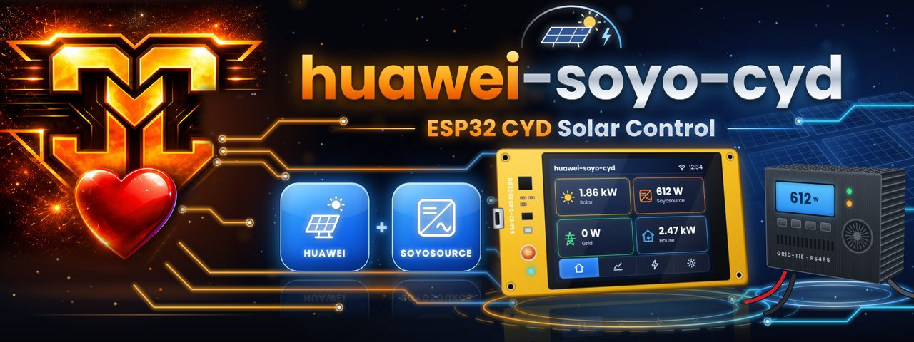

  

<h1 align="center">Huawei · Soyo</h1>
<h3 align="center">Zero export on the Cheap Yellow Display: SoyoSource feeds in, Huawei R48xx charges – local, no cloud, Home Assistant optional</h3>

  
  
  
  
  
  

  
  
  
  

  <a href="README.md">🇩🇪 Deutsch</a> · <strong>🇬🇧 English</strong>

> **Grid connection at zero: import → Soyo feeds in from the battery, surplus → Huawei charges the battery.**

---

A firmware for the inexpensive **ESP32-2432S028R** ("Cheap Yellow Display", 2.8″ touch) that regulates the grid connection to **zero** – with a battery, **SoyoSource** inverters and **Huawei R48xx** rectifiers.

| At the grid connection … | … reacts | Energy path |
| --- | --- | --- |
| **Import** (house needs power) | **SoyoSource** feeds in | battery → house |
| **Export** (e.g. PV surplus) | **Huawei** charges | grid → battery |

## 🚧 Beta – testers and ideas welcome!

Everything is implemented but **not yet fully tested on real hardware**. Start with low power and check each device on its own. If you have a Huawei, Soyo, Shelly or Home Assistant connected and want to test: feedback, logs and ideas are very welcome!

---

📖 Step-by-step guides (German, with an English summary) are in the [wiki](wiki/Home.md).

## Contents

- [Features](#features)
- [Parts](#parts)
- [Wiring](#wiring)
- [Flashing the firmware](#flashing-the-firmware)
- [First start](#first-start)
- [Display](#display)
- [Web interface](#web-interface)
- [Several Huawei rectifiers](#several-huawei-rectifiers)
- [Shelly in front of the Huawei](#shelly-in-front-of-the-huawei-optional)
- [MQTT and Home Assistant](#mqtt-and-home-assistant)
- [Safety](#safety)
- [Troubleshooting](#troubleshooting)
- [Support & donations](#-support--donations)
- [Technology and licenses](#technology-and-licenses)

## Features

- **Zero export** to an adjustable grid target (factory 25 W). Soyo and Huawei **never run at the same time**: before each change of direction both stay at 0 W for 5 s, and Soyo is only released once the Huawei draws less than 40 W – so they cannot push each other up.
- **Charge only** with a fixed power (100–2000 W), start only by holding for 3 s, stop immediately.
- **Several devices:** up to 32 SoyoSource (RS485) and up to 3 Huawei (CAN).
- **Grid meter** via Shelly (EM, 3EM, Pro EM, Pro 3EM, EM Gen4) or any **MQTT** value with JSONPath.
- **Home Assistant** via MQTT discovery: all values appear automatically.
- **Automatic restart** of zero export after a power cut, once readings arrive.
- **Setup by phone:** setup Wi-Fi with captive portal, Wi-Fi search, password-protected web interface.
- **Huawei detail page:** tap the tile → voltage, current, power, temperature and efficiency of each rectifier.
- **Log to microSD card:** one line every 10 s plus all events; when the card is full, the oldest files are deleted.
- **Display sleep:** off after 60 min, on again with a tap or with bright light (light sensor).
- **Shelly in front of each Huawei (optional):** measures the input and switches a Huawei off when its CAN breaks.
- **German and English**, design as in Simple Open Camper.

## Parts

| Part | Used for | Where to buy |
| --- | --- | --- |
| ESP32-2432S028R ("Cheap Yellow Display", 2.8″) | controller with display | [on Amazon](https://link.amazon/B00jjmvuF) |
| CAN transceiver SN65HVD230 (3.3 V) | Huawei rectifiers | [on Amazon](https://link.amazon/B02DRQBV8) |
| RS485 converter with automatic direction | SoyoSource inverters | [on Amazon](https://link.amazon/B092okQsP) |
| Shelly energy meter at the grid connection | grid meter | or another meter via MQTT |
| one Shelly with switch and metering per Huawei (e.g. Plug, 1PM) | switch-off on CAN failure | optional |

Important: for CAN use a **3.3 V transceiver** such as the SN65HVD230, **not an MCP2515** module – the CAN controller is already inside the ESP32.

## Wiring

Each module gets its own connector on the CYD.

### Connector CN1 → CAN module (Huawei)

| CN1 on the CYD | SN65HVD230 |
| --- | --- |
| 3.3 V | 3V3 |
| GND | GND |
| IO22 | CTX |
| IO27 | CRX |

- **CANH / CANL** go in parallel to all Huaweis. The pins on the Huawei connector are in the manual of your model (e.g. R4850G2 manual V2.2: pins 11/12, V1.4: pins 13/14).
- **125 kbit/s.** A CAN bus needs exactly two **120 Ω terminating resistors**, one at each end. The SN65HVD230 boards usually have one already. Check: everything off, measure between CANH and CANL – about **60 Ω** is correct.

### Connector P1 (UART next to the USB socket) → RS485 converter (Soyo)

| P1 on the CYD | RS485 converter |
| --- | --- |
| VIN (5 V) | VCC |
| GND | GND |
| TX (GPIO1) | DI / TXD |
| RX (GPIO3) | **do not connect** |

- **A / B** go in parallel to all Soyos (nothing arrives: swap A and B). 4800 baud, all Soyos in **RS485 limiter mode**.
- **Why RX stays unconnected:** in limiter mode the Soyos only receive, they never answer. And RX on P1 is connected internally to the USB chip – that is how the firmware arrives from the PC when uploading. The converter's RXD pin is an output; connected, two outputs would fight each other and uploading would stop working.

### Why not connector P3 (GND, IO35, IO22, IO21)?

- **IO22** is the same pin as on CN1 (connected on the board) and already used there.
- **IO35** is input only, **IO21** is the display backlight.
- P3 has **no 3.3 V**. So P3 is not enough for either module on its own.

**Consequence of this wiring:** Soyo uses the USB serial (UART0), so there is no serial debug output. Troubleshooting is done in the web interface. Uploading via USB still works. At power-up, boot messages briefly run over the Soyo bus; the Soyos discard them (wrong baud rate and checksum).

## Flashing the firmware

**⚡ [Online flasher](https://cyclemat.github.io/huawei-soyo-cyd/flasher/) (easiest):** open it in the browser (Chrome or Edge on a PC), connect the CYD via USB, press the button, pick the port – no download, no installation. **"Nur Firmware (Update)"** keeps the settings, **"Komplett (neu einrichten)"** erases everything. Unplug the RS485 converter from connector P1 first; it shares the serial port.

**Web flasher on your own PC:** double-click **`flasher.bat`** in the project folder (or `python tools/flasher.py`). It starts a small web server for this PC only and opens **http://localhost:8766/flasher/** – choose the published firmware from `release/` or the one **built locally** (latest state).

**Ready-made files:** [release/](release/) holds `huawei-soyo-cyd.bin` (complete image, via USB at address `0x0`, erases the settings) and `ota/huawei-soyo-cyd.bin` (firmware only, at `0x10000`, settings are kept). Version and commit are listed in [release/README.md](release/README.md). There is no update via the web interface (no OTA).

**Build it yourself:** PlatformIO, `pio run -e cyd -t upload`. Afterwards `python tools/release_local.py` puts the finished files into `release/` and updates the online flasher.

## First start

1. Flash the firmware (see above).
2. Connect to the Wi-Fi **HuaweiSoyo-XXXX** – factory password **`panelsat`**. The settings page opens by itself on the phone (captive portal on **4.3.2.1**), otherwise open `http://4.3.2.1`.
3. **Set your own access password:** enter the default password `panelsat`, below it your own (8 to 63 characters).
4. Tap your home Wi-Fi in the list, enter its password, set up grid meter, Soyo and Huawei → **Save and restart**.
5. The new address of the web interface is then shown on the display under **Settings**.
6. Under **Live**, check that grid import shows as **positive** – otherwise *Invert sign*.
7. Touch inaccurate? Press the screen for 2 s while switching on, after "Release now" tap the arrow tips in the corners.

The setup Wi-Fi also appears when the home Wi-Fi is not reachable at start. If no phone connects for 5 minutes, the device restarts and tries again – important after a power cut when the router takes longer.

**Reset** – switch the device off and on quickly (under 10 s each; crashes do not count):

| Count | Effect |
| --- | --- |
| 3 times | setup Wi-Fi on immediately (until the next restart) |
| 5 times | access and Wi-Fi password back to `panelsat`. The home Wi-Fi is kept so that a flickering grid cannot disable regulation. |

## Display

| Page | Content |
| --- | --- |
| **Home** | tiles *Soyo feed-in* and *Huawei charging* with fill level, below the grid power (import amber, export blue) and notes – e.g. why there is no reading right now |
| **Settings** | address of the web interface or setup Wi-Fi, grid target with − / + |
| **Mode** | *Zero export*, *Charge only*, *Off* – the active mode is amber |

The header shows the mode and, on the right, the state of MQTT, CAN and Wi-Fi (green = fine, red = missing).

**Splash screen:** at power-on the display shows the splash screen (banner artwork with the M emblem) with a progress bar and a status line while the device starts: version, CAN, Wi-Fi (or the setup Wi-Fi name), "Ready". It stays for at least 2.5 s; a tap after start-up skips it. The Soyo and Huawei setpoints are already being sent meanwhile. For your own picture put `splash_cyd.jpg` (320 × 240, baseline JPEG) into the project folder; it is embedded at build time (`tools/embed_splash.py`). The bar sits at x 52–267, y 201–206, the status line below it.

**Zero export:** on import the Soyo feeds in and regulates to the grid target. The Huawei only charges when there is real export and then regulates to 0 W – it never raises the import to reach a positive grid target. After a restart or power cut it continues automatically once valid readings arrive ("Waiting for meter"), then a 5 s pause and a gentle ramp from 0 W.

**Charge only:** hold the button for 1.2 s → charge window. Choose the power with − / + or the slider (up to the charge limit = count × charge voltage × max. current, at most 2000 W). **Hold START for 3 s** to start, **STOP** and **Cancel** act on the first touch. Soyo stays off the whole time. "Charge only" never resumes automatically after a restart.

**Huawei values:** tap the *Huawei charging* tile. At the top: setpoint, charge voltage and max. current; below, per rectifier: connected / no data, output voltage, charging current, DC power, AC input, mains voltage, temperature and efficiency. **Back** closes the page.

**Display sleep:** after 60 minutes without a touch the backlight goes off (adjustable, 0 = never). It comes back on with a **tap** – the first touch only wakes and does not press a button – or when the **light sensor** sees a strong rise in brightness (light on, door open). How strong the rise must be is set in the web interface (10–90 %, default 40 %, lower = more sensitive); it also shows the current sensor value (high value = dark). Regulation keeps running while asleep.

**Log to microSD card:** with a card (FAT32) in the CYD's slot, the device writes one line every 10 s (mode, grid, Soyo, Huawei, grid target) and all events (start with reason, mode change, missing reading, CAN lost, Wi-Fi lost, "charging stopped" …) to `/logs/log-NNNNN.csv` – semicolon-separated, opens directly in Excel/LibreOffice, at most 1 MB per file. When less than 8 MB is free, the oldest files are deleted. The time comes from the internet (NTP); without internet only the uptime in seconds is logged. A card inserted later is detected within 30 s. Files can be downloaded in the web interface under *Log files*.

## Web interface

Light or dark (follows the device), German or English (top right), protected by the access password (5 wrong attempts → 30 s pause).

| Section | Settings |
| --- | --- |
| **Live** | live values, connection status, Wi-Fi signal, reason for a missing reading |
| **Wi-Fi** | search with signal strength, tap a network, password |
| **Grid meter** | *Shelly* (IP, channel or sum of all phases) or *MQTT topic* (topic, JSONPath, timeout) · sign · grid target (−200 to 200 W, negative = small export) · control interval (0.5 to 60 s) |
| **SoyoSource** | count, max. power per unit, optionally a Shelly at the Soyo output for the actual value |
| **Huawei** | model (sets the CAN current factor), count, charge voltage, max. current · behaviour **without CAN signal** · optionally one Shelly per Huawei (IP) and *Switch off when CAN fails* |
| **MQTT / Home Assistant** | broker, credentials, topic prefix, discovery |
| **Access** | setup Wi-Fi password (or open), language |
| **Display and log** | display off after … minutes, on again with bright light, light sensor threshold with live value, log to SD card on/off |
| **Log files** | free space, files to download, delete old logs |
| **Device** | change access password, calibrate touch, **Diagnostics**, sign out |

**Diagnostics (Device → Diagnostics):** since the USB serial belongs to the Soyo, troubleshooting runs over the network. The page shows the CAN driver state, counters (frames received per Huawei, frames with a foreign address including the last ID, rejected transmissions, bus-off restarts, error counters TEC/REC, lost frames), per Huawei its address, last answer and values, the events since start (same as the SD log, kept in RAM, also without a card) and on request a **CAN capture** of the next 64 frames (TX and RX, 10 s at most). **Download report** saves everything as a text file (`huawei-soyo-diagnose.txt`, no passwords) to pass on when asking for help. Also available at `/diag.txt` after signing in. *(Beta)*

**Huawei model and current factor:** the Huawei expects the current over CAN as amps × factor, factor = 1024 ÷ rated current. The charge voltage ranges from 45 to 60 V; the Huawei limits itself to its own maximum (R4850G2: 58.5 V).

| Model | Rated current | Factor |
| --- | --- | --- |
| R4830G | 30 A | 34.13 |
| R4850G2 | 50 A | 20.48 |
| R4875G1 | 75 A | 13.65 |
| Custom factor | – | enter yourself |

## Several Huawei rectifiers

- **The rectifiers assign their addresses themselves:** when first switched on together on one bus they agree on 1, 2, 3 and keep them afterwards. Nothing is set on the device. Which unit gets which address depends on the power-up order.
- Enter the **count** in the web interface. The CYD talks to addresses **1 to count**, gives all of them the same charge voltage and **splits the power evenly** (e.g. 1500 W with three units = 500 W each).
- Charging only runs when **all configured** units answer – otherwise "no CAN" and charging stops.
- **A single unit** may have any address: if it answers as address 2, for example, the CYD adopts that address by itself (event "Huawei answers with CAN address 2") and talks to it from then on.
- **Known limit with several units:** the CYD expects the addresses without gaps starting at 1. Which addresses actually answer is shown on the diagnostics page under "foreign ID" (0x108**2**407F = address 2).

## Shelly in front of the Huawei (optional)

Put a Shelly with a switch and power metering in front of each Huawei (e.g. Shelly Plug, Plus Plug S, 1PM, Plus 1PM; Gen1 and Gen2/3, without password). In the web interface under **Huawei**, enter one IP address per rectifier: *Shelly in front of Huawei 1* belongs to the Huawei with CAN address 1, and so on. **If the fields stay empty, nothing happens** – everything works as without Shellys.

| Case | What the CYD does |
| --- | --- |
| CYD restarts | switches all configured Shellys **on** (the Huawei needs power to report on the CAN) |
| Huawei sends **no CAN data for 15 s** (cable off, transceiver broken) | switches **this** Huawei **off** via its Shelly |
| Huawei draws **over 100 W for 30 s** while it should be off | switches it **off** via its Shelly |
| 5 min after switching off | switches on again and waits up to 60 s for the CAN; if it is still missing, off again |
| a Huawei draws **over 40 W** according to its Shelly | Soyo stays blocked (in addition to the CAN reading) |

After switching on, each Huawei gets 60 s to start up. The state is shown on the Huawei page of the display in the top right of each tile (red = switched off), in the web interface under *Live* and via MQTT as `h1_plug` … `h3_plug` (W). With *Switch off when CAN fails* **off**, the CYD only measures and leaves the Shellys on.

Limit: if the **CYD itself** fails, nobody switches the Shellys either – the offline current of 0 A still applies (see Safety). The CYD also switches off when the CAN has been missing since start-up.

## MQTT and Home Assistant

**Grid meter via MQTT** – examples:

| Device | Topic | JSONPath |
| --- | --- | --- |
| Tasmota reading head | `tele/zaehler/SENSOR` | `$.ENERGY.Power` (depending on the meter e.g. `$.SML.Power_curr`) |
| Shelly Gen2/3 (Pro 3EM) | e.g. `shellypro3em/status/em:0` | `$.total_act_power` |
| Shelly Gen1 EM | `shellies/<name>/emeter/0/power` | empty (the message is just a number) |

Supported: `$.a.b`, `a[0].b` and `$['em:0'].act_power`; numbers sent as text work too. If no value arrives for longer than the timeout (factory 15 s), Soyo and Huawei go to 0 W.

**Values for Home Assistant:** with a broker configured, the CYD publishes a JSON on `<prefix>/state` (factory `huaweisoyo/state`) every 5 s and its availability on `<prefix>/status`. With discovery, the device **"Huawei Soyo controller"** appears with grid power, Soyo setpoint and measurement, Huawei setpoint, charging and input power, grid target, mode and per Huawei output voltage, charging current, mains voltage, temperature and efficiency. When Home Assistant restarts, the CYD sends the discovery again.

## Safety

- **Grid reading missing** (Shelly longer than 10 s, MQTT longer than the timeout): Soyo and Huawei go to 0 W. Until then the regulation holds the last value so that single dropouts do not switch anything off.
- **Huawei CAN missing:** charging stops; Soyo may keep feeding in. Without a CAN module connected, everything else keeps running normally.
- **CYD fails or CAN cable is unplugged:** with *Without CAN signal → keep charging* **off** (factory), the CYD writes an offline current of **0 A** into the Huawei's memory on first contact; after losing the connection it should stop charging with that. **Not yet tested on the device** – on first setup charge with low power, unplug CAN and check with a clamp meter whether and when the Huawei stops. A Huawei that has never been connected to the CYD still has its factory defaults.
- **Second safeguard via Shelly (optional):** if only the CAN breaks and the CYD keeps running, it switches the affected Huawei off via its Shelly (see [Shelly in front of the Huawei](#shelly-in-front-of-the-huawei-optional)). *(Beta)*
- The battery must always be protected by its **BMS** against overcharging and deep discharge.
- Soyo actual value only via Shelly. Control from Home Assistant is not built in yet.

## Troubleshooting

| Message | Cause and fix |
| --- | --- |
| "no reading" / "Shelly does not respond" | check the IP, look at the Wi-Fi signal under *Live* (worse than about −75 dBm is too weak) |
| "Shelly requires a password" | turn off authentication on the Shelly – the firmware queries without a password |
| "unknown Shelly format" | model not supported – use measuring via MQTT |
| "CAN" red | open web interface → Device → **Diagnostics**: "has never answered" → swap CTX and CRX, check CANH/CANL, measure the termination (≈ 60 Ω); "foreign ID" → check count or addresses; bus-off or high error counters → wiring, ground, transceiver |
| "CAN" was green and turns red | Diagnostics → events: the reason is listed there ("no answer for …", "bus-off", "too hot", "off via Shelly"). Download the report and attach it when asking |
| "No Huawei configured" / "Charge voltage or max. current missing" | fill in web interface → Huawei |
| Soyo does not feed in | swap A and B, check limiter mode on the Soyos, RX on P1 not connected? |
| Grid import shows as negative | turn on *Invert sign* |

## ❤ Support & donations

This project is built in my spare time. If it helps you, I am happy about a coffee:

**[☕ PayPal – support CycleMat](https://paypal.me/cyclemat)**

No pressure, no ads, no paywall – just open source with passion ❤

## Technology and licenses

PlatformIO, Arduino-ESP32 2.0.17, LVGL 8.4, LovyanGFX (display and touch as in Simple Open Camper), PubSubClient. Partition `huge_app.csv` (no OTA).

| File | Content |
| --- | --- |
| `src/main.cpp` | regulation, CAN (Huawei), RS485 (Soyo), Shelly polling |
| `src/dispatch.h` | controller: one signed setpoint, change of direction only via 0 W |
| `src/ui.cpp` | display and touch |
| `src/web.cpp` | web interface |
| `src/devsetup.cpp` | access password, setup Wi-Fi, multi-reset |
| `src/mqtt.cpp` | MQTT topic and Home Assistant discovery |
| `src/sdlog.cpp` | log to the microSD card |
| `src/hwplug.cpp` | Shelly in front of the Huawei rectifiers |
| `tools/embed_splash.py` | embed the splash screen (`assets/splash_cyd.jpg`) at build time |

Protocol knowledge from [mjpalmowski/CAN-BUS-control-R4875G1](https://github.com/mjpalmowski/CAN-BUS-control-R4875G1-with-ESPHome-and-MQTT) (MIT), [craigpeacock/Huawei_R4850G2_CAN](https://github.com/craigpeacock/Huawei_R4850G2_CAN) (GPL-3.0, protocol knowledge only, own implementation) and [matlen67/soyosource-powercontroller](https://github.com/matlen67/soyosource-powercontroller) (protocol knowledge only). Third-party parts: [THIRD_PARTY.md](THIRD_PARTY.md) · Changes: [CHANGELOG.md](CHANGELOG.md)
